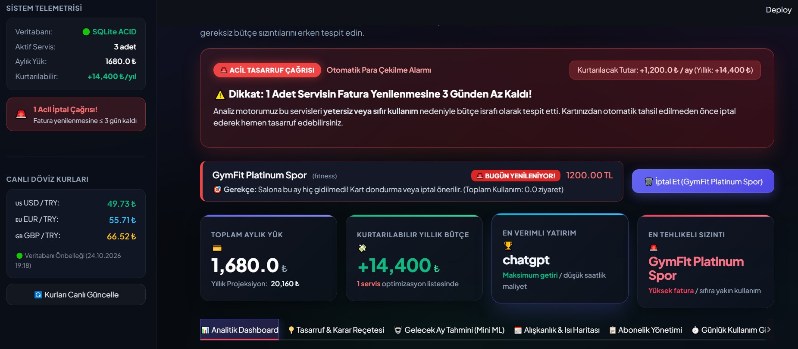
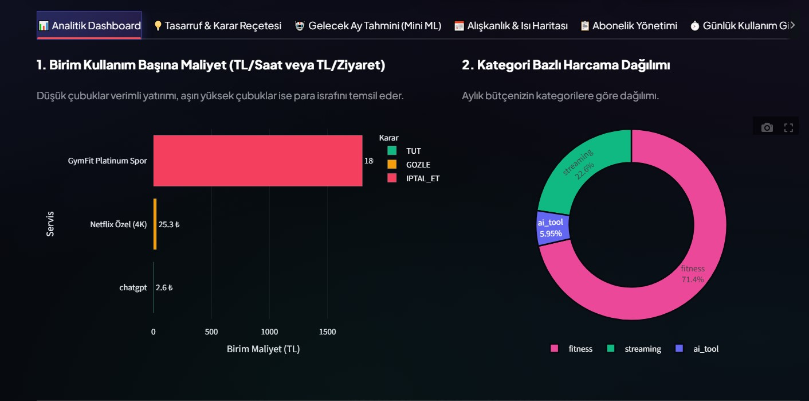
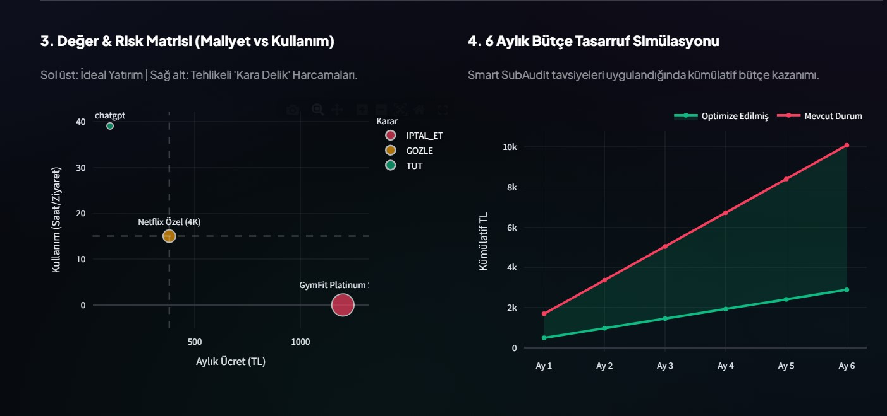
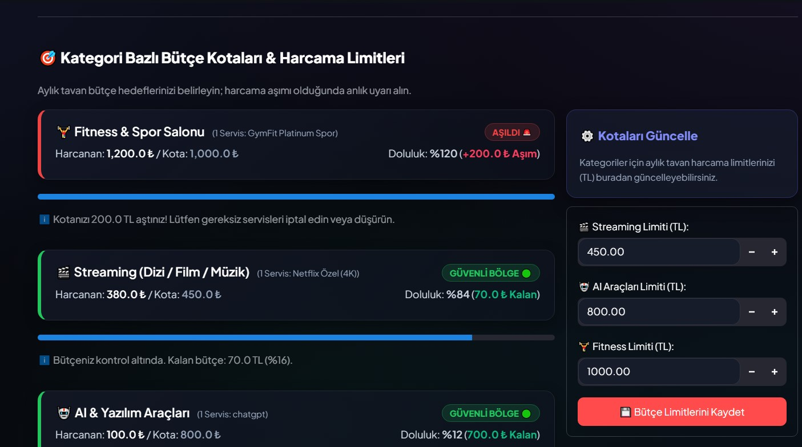

# 🔍 Smart SubAudit — Dijital Abonelik & Birim Kullanım Başına Maliyet Denetleyicisi

<p align="center">
  
  
  
  
  
  
</p>

---

## 📌 Proje Genel Bakış & Problem Tanımı

Günümüzde Netflix, Spotify, ChatGPT Plus, YouTube Premium, Cloud Depolama ve Spor Salonu gibi onlarca servise her ay düzenli ödeme yapıyoruz. Klasik bütçe ve harcama takip uygulamaları yalnızca *"bu ay toplam ne kadar harcadığınızı"* söyler; ancak yapılan harcamanın **gerçekten karşılığını verip vermediğini** analiz edemez.

**Smart SubAudit**, aboneliklerinizi **"Birim Kullanım Başına Maliyet (Cost-per-Unit)"** prensibiyle denetleyen yeni nesil bir akıllı finansal denetim platformudur:
- *"Netflix'e 380 TL ödediniz ama bu ay sadece 2.5 saat izlediniz (152 TL/saat) ➔ **İPTAL ET / DÜŞÜR**"*
- *"ChatGPT Plus'a ~990 TL ödediniz ve 38 saat kod yazdınız (26 TL/saat) ➔ **MÜKEMMEL YATIRIM (TUT)**"*
- *"Spor Salonuna 1.200 TL ödediniz ve bu ay hiç gitmediniz (0 ziyaret) ➔ **ACİL İPTAL / DONDUR**"*

Sistem, yapay zekâ tabanlı kullanım tahminleri, çapraz paket (bundle) çakışma tespiti, otomatik döviz dönüşümü ve fatura yenilenme alarmlarıyla bütçenizdeki gizli finansal sızıntıları kartınızdan para çekilmeden önce önler.

---

## 📸 Ekran Görüntüleri & Görsel Arayüz Turu

### 1. Finansal Kontrol Paneli & Acil Para Çekilme Alarmı
> *Özet KPI kartları (Aylık Yük, Kurtarılabilir Yıllık Bütçe, En Verimli Yatırım, En Tehlikeli Sızıntı), canlı döviz kurları ve faturası yaklaşan israf servisler için acil iptal uyarıları.*



---

### 2. Birim Kullanım Başına Maliyet Analizi & Kategori Dağılımı
> *Hangi servisin birim saat/ziyaret başına ne kadara mal olduğunu gösteren renk kodlu kıyaslama çubukları ve kategori bazlı bütçe payı (Donut grafik).*



---

### 3. Değer & Risk Matrisi ve 6 Aylık Tasarruf Simülasyonu
> *Maliyet ve kullanım yoğunluğunu çaprazlayan Değer & Risk Matrisi (Scatter Plot) ile Smart SubAudit tavsiyeleri uygulandığında elde edilen kümülatif tasarruf projeksiyonu.*



---

### 4. Kategori Bazlı Bütçe Kotaları & Harcama Limitleri
> *Streaming, Yapay Zekâ ve Spor gibi kategoriler için aylık harcama tavan limitleri; kota aşımı ve kritik bölge doluluk uyarıları.*



---

## 🛠️ Kullanılan Teknolojiler & Mimari

| Alan | Teknoloji / Kütüphane | Kullanım Amacı |
| :--- | :--- | :--- |
| **Programlama Dili** | `Python 3.11+` | Çekirdek iş mantığı, OOP ve analitik altyapı |
| **Web Arayüzü** | `Streamlit 1.62+` | Obsidian Dark & Glassmorphism FinTech arayüzü |
| **Veritabanı** | `SQLite3 (ACID)` | İlişkisel veri modeli, `FOREIGN KEY` & `ON DELETE CASCADE` |
| **Veri Analitiği** | `Pandas` & `NumPy` | DataFrame dönüşümleri, gruplamalar ve kümülatif simülasyonlar |
| **Makine Öğrenmesi**| `Scikit-Learn` | Lineer Regresyon (OLS) ile Gelecek Ay Kullanım ve Maliyet Sapması Tahmini |
| **Görselleştirme** | `Plotly Express / Graph Objects` | İnteraktif scatter plot, bar, çizgi ve donut grafikleri |
| **Raporlama Paneli**| `Matplotlib` | 4 panelli yüksek çözünürlüklü gösterge paneli çıktısı |
| **PDF Rapor Motoru**| `ReportLab 5.0` | Kurumsal A4 Türkçe karakter uyumlu resmi finans raporu üretimi |
| **Döviz Entegrasyonu**| `Requests` & `open.er-api.com` | Canlı USD/TRY, EUR/TRY, GBP/TRY kurları ve SQLite TTL önbellekleme |
| **Test & Kalite** | `Unittest` | 21 senaryolu tam kapsamlı Unit & Entegrasyon test paketi |

---

## 🌟 Temel Yetenekler & Özellikler

### 1. 🏗️ İleri Düzey Nesne Yönelimli Programlama (OOP)
* **Soyut Taban Sınıf (`ABC`):** `Subscription` soyut sınıfı ortak özellikleri (`__name`, `__monthly_cost`, `__renewal_day`) kapsüller (`__private`).
* **Çok Biçimlilik (Polymorphism):** `@abstractmethod` ile `calculate_value_score()` ve `get_recommendation()` alt sınıflara göre özelleştirilmiştir:
  - `StreamingSub`: Saatlik izleme/dinleme maliyeti ve tolerans katsayısı.
  - `AIToolSub`: Üretken çalışma saati maliyeti ve yüksek verimlilik toleransı.
  - `FitnessSub`: Ziyaret başına katılım maliyeti.
* **Fabrika Deseni (Factory Pattern):** `subscription_factory()` dinamik nesne üretimi sağlar.

### 2. 🗄️ İlişkisel Veritabanı Mimarisi (SQLite3)
* `subscriptions` ve `usage_logs` tabloları arasında Foreign Key ilişkisi.
* `ON DELETE CASCADE`: Bir abonelik silindiğinde ona ait tüm kullanım logları otomatik temizlenir.
* Eski CSV dosyalarından otomatik ACID migrasyon mekanizması.

### 3. 💱 Canlı Döviz Kuru API Entegrasyonu & TTL Cache
* Yabancı para birimlerinde (USD, EUR, GBP) ödenen servisleri güncel kurlarla TL'ye çevirir.
* Canlı REST API'ye (`open.er-api.com`) istek atar ve kurları 1 saat boyunca SQLite'da önbelleğe alır. İnternet kesilirse güvenli fallback kurlar devreye girer.

### 4. 🤖 Mini Makine Öğrenmesi ile Gelecek Ay Tahmini (OLS)
* Geçmiş günlük/haftalık kullanım serilerini Scikit-Learn Lineer Regresyon modeliyle eğitir.
* Gelecek 30 günlük kullanım trendini ve olası **Cost Drift** (Kullanım düşüşü nedeniyle fırlayacak birim maliyet) risklerini önceden bildirir. Model başarısını $R^2$ skoruyla şeffaf olarak sunar.

### 5. 📦 Çapraz Paket (Bundle Optimizer) & Tasarruf Reçetesi
* Sepetteki çakışan servisleri tespit eder (Örn: Hem Spotify hem YouTube Premium ödüyorsanız YouTube Music zaten dahil olduğu için Spotify'ı iptal ederek yılda 700+ TL tasarruf ettirir).
* Pazar araştırması veritabanıyla daha ucuz alt planlar veya ücretsiz alternatifler önerir.

### 6. 📅 GitHub Tarzı Aktivite Isı Haritası (Heatmap & Streak)
* Kullanım sıklığını 7 günlük ızgara şeklinde görselleştirir.
* Üst üste kullanım serilerini (*streak*), hafta içi/hafta sonu yığılmalarını ve zirve günlerini analiz eder.

### 7. 📄 Kurumsal A4 PDF Finans Raporu Üretimi
* ReportLab altyapısı ile Türkçe karakter destekli kurumsal yönetici finans raporu üretir. Web arayüzünden tek tıkla indirilebilir.

---

## 📁 Proje Dosya Yapısı

```
SmartSubAudit/
│
├── assets/
│   └── screenshots/             # README ve dokümantasyon ekran görüntüleri
│       ├── screenshot_1.jpg     # Finansal Kontrol Paneli & Acil Alarm
│       ├── screenshot_2.jpg     # Birim Maliyet & Kategori Dağılımı
│       ├── screenshot_3.jpg     # Değer & Risk Matrisi & Tasarruf Simülasyonu
│       └── screenshot_4.jpg     # Kategori Bütçe Kotaları & Limitler
│
├── data/
│   ├── subscriptions.csv        # Başlangıç/yedek abonelik verileri
│   ├── usage_log.csv            # Başlangıç/yedek kullanım kayıtları
│   └── smart_subaudit.db        # SQLite3 ilişkisel veritabanı
│
├── tests/
│   └── test_subaudit.py         # 21 senaryolu kapsamlı test paketi
│
├── models.py                    # OOP sınıfları & Fabrika deseni
├── data_manager.py              # SQLite3 ACID CRUD & Migrasyon katmanı
├── analytics.py                 # Finansal analiz, kotalar & ısı haritası motoru
├── ml_predictor.py              # Scikit-Learn zaman serisi regresyonu & tahmin
├── recommendation_engine.py     # Alternatif paketler & Bundle Advisor
├── currency_service.py          # Canlı REST API kurları & TTL önbellek
├── pdf_generator.py             # ReportLab A4 Türkçe finansal PDF raporlayıcı
├── visualizer.py                # Matplotlib 4 panelli statik gösterge paneli
├── app.py                       # Modern Streamlit Web Arayüzü
├── main.py                      # İnteraktif Terminal / CLI konsolu
├── requirements.txt             # Bağımlılıklar listesi
├── .gitignore                   # Git dışlama kuralları
└── README.md                    # Detaylı proje dokümantasyonu
```

---

## 🚀 Hızlı Başlangıç & Kurulum

### 1. Depoyu Klonlayın
```bash
git clone https://github.com/Rasittekin18/SmartSubAudit.git
cd SmartSubAudit
```

### 2. Sanal Ortam Oluşturun ve Aktif Edin (Önerilen)
```bash
# Windows
python -m venv venv
venv\Scripts\activate

# macOS / Linux
python3 -m venv venv
source venv/bin/activate
```

### 3. Bağımlılıkları Yükleyin
```bash
pip install -r requirements.txt
```

### 4. Uygulamayı Başlatın

#### A) Modern Web Arayüzü (Streamlit):
```bash
streamlit run app.py
```
*Tarayıcınızda otomatik olarak `http://localhost:8501` adresinde açılacaktır.*

#### B) Konsol Menüsü (CLI):
```bash
python main.py
```

---

## 🧪 Testleri Çalıştırma

Tüm modülleri (OOP, SQLite, Döviz, ML, PDF, Kotalar, Isı Haritası vb.) kapsayan 21 birim ve entegrasyon testini çalıştırmak için:

```bash
python -m unittest discover tests
```

---

## 📄 Lisans

Bu proje [MIT Lisansı](LICENSE) kapsamında lisanslanmıştır. Özgürce kullanılabilir, geliştirilebilir ve dağıtılabilir.
